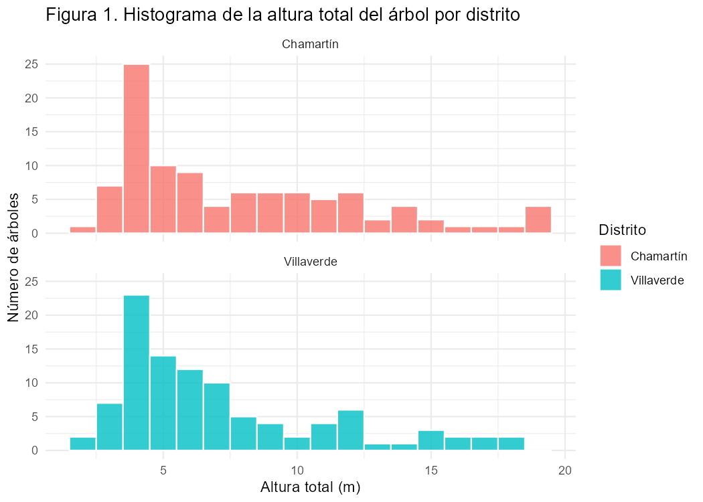
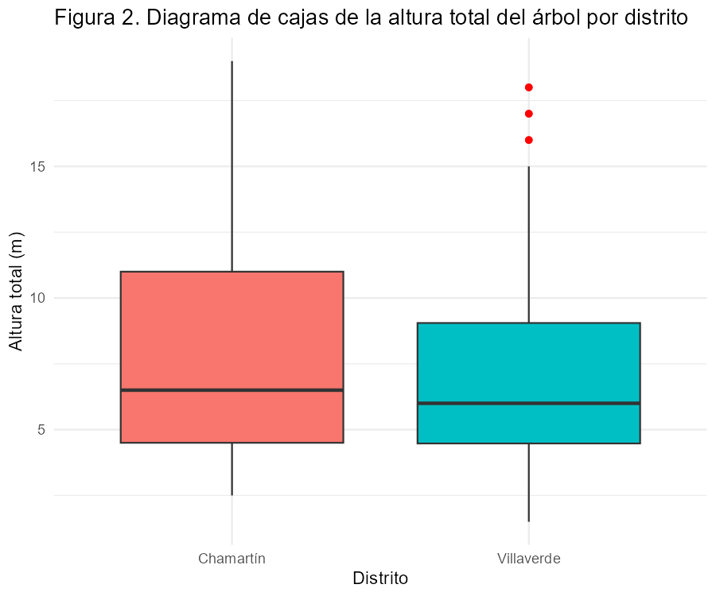
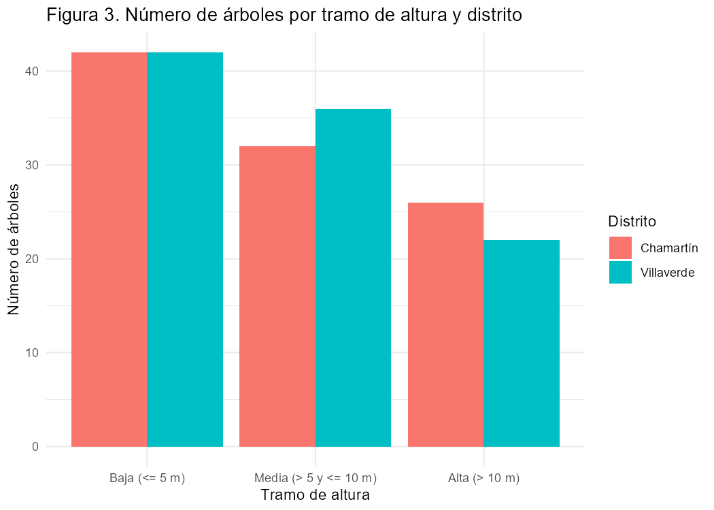
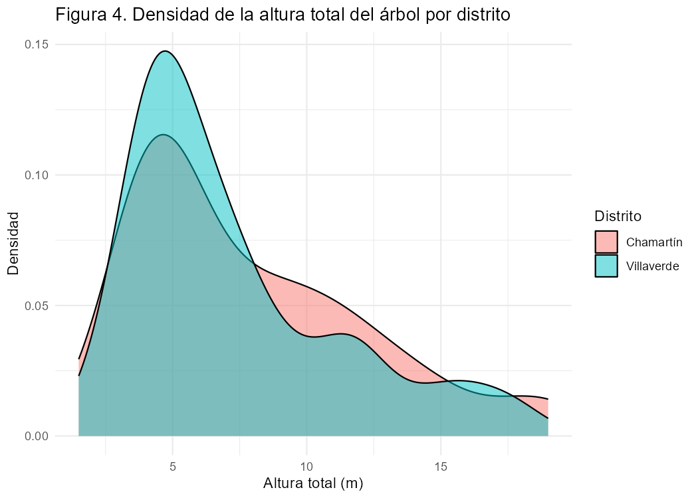

# Altura de los árboles municipales en Chamartín y Villaverde (Madrid)

**PL1: Informe de Estadística Descriptiva**
Universidad de Alcalá · Grado en Ingeniería de Computadores (GIC) · Estadística
Autor: Adrián Tébar Molano · Grupo 1B1 · Curso 2026/2027

> Este repositorio publica el informe de la PL1 en formato Markdown. También contiene las figuras y el proyecto de RStudio con los datos y el código.
>
> **Diagramas interactivos (se abren en el navegador):**
> [Figura 5: diagrama de cajas](https://quijoteanima-code.github.io/pl1-estadistica-arbolado-madrid/figuras/figura5_boxplot_interactivo.html) ·
> [Figura 6: histograma](https://quijoteanima-code.github.io/pl1-estadistica-arbolado-madrid/figuras/figura6_histograma_interactivo.html)

## Índice

1. [Introducción](#1-introducción)
2. [Metodología](#2-metodología)
3. [Resultados](#3-resultados)
4. [Análisis de resultados](#4-análisis-de-resultados)
5. [Conclusiones](#5-conclusiones)
6. [Referencias](#6-referencias)

## 1. Introducción

### 1.1 Contexto

El Ayuntamiento de Madrid mantiene un inventario de los árboles de titularidad municipal que se encuentran en calles, parques y zonas verdes de la ciudad. Cada árbol ocupa una fila del inventario, con su distrito, su barrio, su especie, sus coordenadas, el perímetro del tronco y la altura total. La edición de 2026 recoge 799.110 árboles de todos los distritos de Madrid.

Este informe corresponde a la prueba de evaluación PL1 de la asignatura de Estadística. En él se aplican las medidas y los diagramas de la estadística descriptiva a una variable cuantitativa de ese inventario, comparando dos grupos definidos por una variable cualitativa.

### 1.2 Objetivo

El objetivo es describir la altura total de los árboles de los distritos de Chamartín y Villaverde y comparar ambos grupos mediante medidas estadísticas, tablas de contingencia y diagramas, para comprobar si los árboles de un distrito son más altos o tienen alturas más variables que los del otro.

### 1.3 Alcance

El estudio se limita a una muestra aleatoria de 200 árboles, 100 de cada distrito, extraída del inventario completo. El análisis es descriptivo: los resultados se refieren a la muestra y no se hacen pruebas de inferencia, por lo que no se generalizan al resto del arbolado de los dos distritos, a otros distritos ni a otros años.

## 2. Metodología

### 2.1 Origen de los datos

Los datos proceden del conjunto «Arbolado en parques y zonas verdes de Madrid (detalle)», publicado por el Ayuntamiento de Madrid en su portal de datos abiertos con licencia Creative Commons Attribution 4.0 (CC BY 4.0). La página del conjunto de datos, indicada en el foro «Datos elegidos para PL1», es <https://datos.madrid.es/dataset/300761-0-arbolado-especies>. El archivo original es el recurso CSV «Arbolado 2026», que se descarga desde la pestaña «Descargas» de esa página: <https://datos.madrid.es/dataset/300761-0-arbolado-especies/downloads>. El conjunto de datos se actualizó el 27 de julio de 2026 y el archivo se descargó el 29 de septiembre de 2026.

El archivo original tiene 799.110 filas, una por árbol, y 12 columnas: identificador del árbol, número de parque, número y nombre del distrito, número y nombre del barrio, coordenadas X e Y, código y nombre de la especie, perímetro del tronco (cm) y altura total (m). De ese archivo se tomaron los árboles de Chamartín (26.092) y de Villaverde (47.233) y se descartaron los que no tenían anotada la altura o el perímetro (12 en Chamartín y 1 en Villaverde). Después se eligieron al azar 100 árboles de cada distrito con la función `sample` de R y la semilla 2026, de modo que la selección se puede repetir. La muestra está en el archivo [`arbolado_chamartin_villaverde.csv`](proyecto_RStudio/arbolado_chamartin_villaverde.csv), incluido en el proyecto de RStudio.

### 2.2 Herramientas

Los cálculos y los diagramas se hicieron en RStudio con R 4.6.1 y los paquetes ggplot2 (diagramas estáticos), plotly y htmlwidgets (diagramas interactivos) y e1071 (coeficiente de asimetría y curtosis). El código en R se generó con ayuda de un asistente de inteligencia artificial (Claude) y se revisó y ejecutó en RStudio. El informe se editó con Microsoft Word y se publicó en este repositorio en formato Markdown.

### 2.3 Diseño

La variable cuantitativa objeto de estudio es la «altura total del árbol», expresada en metros. Para cada árbol del inventario indica cuántos metros mide de altura total, según el dato que el Ayuntamiento de Madrid registra en su inventario de arbolado de 2026. Su unidad es, por tanto, metros de altura de un árbol. Un individuo de la población es un árbol de titularidad municipal situado en una calle, un parque o una zona verde del distrito de Chamartín o del distrito de Villaverde de Madrid, que figura en el inventario de arbolado del Ayuntamiento de Madrid actualizado en 2026.

La variable cualitativa que define los grupos es el distrito en el que está el árbol, con dos categorías: Chamartín, en el norte de la ciudad, y Villaverde, en el sur. Cada fila del archivo de la muestra corresponde a un árbol, de modo que el tamaño de cada grupo es el número de árboles y no la suma de sus alturas.

## 3. Resultados

### 3.1 Muestras

La muestra tiene 200 árboles: 100 del distrito de Chamartín y 100 del distrito de Villaverde, por encima del mínimo de 30 por grupo. Cada fila del archivo corresponde a un árbol e incluye su identificador, distrito, barrio, especie, perímetro del tronco (cm) y altura total (m).

### 3.2 Medidas estadísticas

La tabla 1 recoge las medidas de la altura total para cada distrito y para la muestra completa.

**Tabla 1.** Medidas estadísticas de la altura total del árbol (m), por distrito y para la muestra completa

| Medida | Chamartín | Villaverde | Total muestra |
|---|---:|---:|---:|
| Tamaño muestral (n) | 100 | 100 | 200 |
| Media (m) | 7,94 | 7,25 | 7,60 |
| Mediana (m) | 6,50 | 6,00 | 6,00 |
| Moda (m) | 4,00 | 4,00 | 4,00 |
| Desviación típica (m) | 4,35 | 3,95 | 4,16 |
| Varianza (m²) | 18,89 | 15,61 | 17,28 |
| Coeficiente de variación (%) | 54,77 | 54,47 | 54,73 |
| Mínimo (m) | 2,50 | 1,50 | 1,50 |
| Primer cuartil Q1 (m) | 4,50 | 4,47 | 4,50 |
| Tercer cuartil Q3 (m) | 11,00 | 9,05 | 10,00 |
| Máximo (m) | 19,00 | 18,00 | 19,00 |
| Rango (m) | 16,50 | 16,50 | 17,50 |
| Rango intercuartílico (m) | 6,50 | 4,58 | 5,50 |
| Coeficiente de asimetría | 0,93 | 1,11 | 1,03 |
| Curtosis | −0,04 | 0,31 | 0,18 |

### 3.3 Tablas de contingencia

Para construir las tablas de contingencia, la altura total se agrupó en tres tramos: baja (5 metros o menos), media (más de 5 y hasta 10 metros) y alta (más de 10 metros). La tabla 2 cruza esos tramos con el distrito y la tabla 3 da los mismos datos en porcentaje sobre el total de árboles de cada distrito.

**Tabla 2.** Número de árboles por distrito y tramo de altura

| Distrito | Baja (≤ 5 m) | Media (> 5 y ≤ 10 m) | Alta (> 10 m) | Total |
|---|---:|---:|---:|---:|
| Chamartín | 42 | 32 | 26 | 100 |
| Villaverde | 42 | 36 | 22 | 100 |
| **Total** | 84 | 68 | 48 | 200 |

**Tabla 3.** Porcentaje de árboles de cada distrito en cada tramo de altura

| Distrito | Baja (≤ 5 m) | Media (> 5 y ≤ 10 m) | Alta (> 10 m) |
|---|---:|---:|---:|
| Chamartín | 42,0 % | 32,0 % | 26,0 % |
| Villaverde | 42,0 % | 36,0 % | 22,0 % |

### 3.4 Diagramas

Las figuras 1 a 4 se generaron con ggplot2 a partir de la muestra.

**Figura 1.** Histograma de la altura total del árbol (m), por distrito

**Figura 2.** Diagrama de cajas de la altura total del árbol (m), por distrito

**Figura 3.** Número de árboles por tramo de altura y distrito

**Figura 4.** Densidad de la altura total del árbol (m), por distrito

Además, se hicieron dos diagramas interactivos con plotly: un diagrama de cajas que muestra los 200 árboles como puntos ([figura 5](https://quijoteanima-code.github.io/pl1-estadistica-arbolado-madrid/figuras/figura5_boxplot_interactivo.html)) y un histograma con los dos distritos superpuestos ([figura 6](https://quijoteanima-code.github.io/pl1-estadistica-arbolado-madrid/figuras/figura6_histograma_interactivo.html)). En ambos se puede ampliar una zona, ocultar un distrito y leer la altura de cada árbol al pasar el cursor por encima.

## 4. Análisis de resultados

Según la tabla 1, la altura media es de 7,94 metros por árbol en Chamartín y de 7,25 metros por árbol en Villaverde, una diferencia de 0,69 metros. La mediana va en el mismo sentido: 6,50 metros en Chamartín y 6,00 metros en Villaverde. En los dos distritos la media supera a la mediana, porque unos pocos árboles muy altos elevan la media. La moda es de 4,00 metros en ambos distritos, con 13 árboles de esa altura en Chamartín y 14 en Villaverde.

La desviación típica es de 4,35 metros en Chamartín y de 3,95 metros en Villaverde, así que las alturas de Chamartín están algo más dispersas en términos absolutos. Como la media de Chamartín también es mayor, el coeficiente de variación queda casi igual en los dos grupos (54,77 % en Chamartín y 54,47 % en Villaverde): en proporción a su media, la altura varía lo mismo en ambos distritos.

La diferencia entre distritos se concentra en la parte alta de la distribución. El primer cuartil es casi el mismo (4,50 metros en Chamartín y 4,47 metros en Villaverde), pero el tercer cuartil llega a 11,00 metros en Chamartín y se queda en 9,05 metros en Villaverde. Por eso el rango intercuartílico es de 6,50 metros en Chamartín y de 4,58 metros en Villaverde. El rango coincide en los dos distritos, 16,50 metros, aunque desplazado: va de 2,50 a 19,00 metros en Chamartín y de 1,50 a 18,00 metros en Villaverde.

El histograma de la figura 1 y las curvas de densidad de la figura 4 muestran dos distribuciones asimétricas a la derecha: la mayor parte de los árboles mide entre 3 y 8 metros (59 en Chamartín y 69 en Villaverde) y hay una cola de árboles más altos. El coeficiente de asimetría es positivo en los dos casos, 0,93 en Chamartín y 1,11 en Villaverde, algo mayor en Villaverde. La curtosis es de −0,04 en Chamartín y de 0,31 en Villaverde; tomando como referencia el valor 0 de la distribución normal, Chamartín tiene un apuntamiento casi igual al de la normal y Villaverde algo mayor.

Las tablas 2 y 3 y la figura 3 muestran el reparto por tramos de altura. El 42,0 % de los árboles de cada distrito mide 5 metros o menos, de modo que en el tramo bajo no hay diferencia. En el tramo alto, de más de 10 metros, está el 26,0 % de los árboles de Chamartín y el 22,0 % de los de Villaverde. En el tramo medio ocurre lo contrario: 36,0 % en Villaverde y 32,0 % en Chamartín. Como cada distrito aporta 100 árboles, cada punto porcentual equivale a un árbol, y las diferencias en los tramos medio y alto son de cuatro árboles.

En el diagrama de cajas de la figura 2, la caja de Chamartín está más arriba y es más larga que la de Villaverde, y su bigote superior llega a 19,00 metros sin valores atípicos. En Villaverde, con el criterio de 1,5 veces el rango intercuartílico, el límite superior queda en 15,91 metros y lo superan seis árboles: dos de 16, dos de 17 y dos de 18 metros. En la figura 2 solo se ven tres puntos rojos porque cada uno corresponde a dos árboles con la misma altura; en el diagrama interactivo de la figura 5 se pueden distinguir los seis.

## 5. Conclusiones

En la muestra estudiada, los árboles de Chamartín son algo más altos que los de Villaverde: la altura media es de 7,94 metros por árbol frente a 7,25 metros por árbol, y la mediana es de 6,50 metros frente a 6,00 metros.

Los árboles bajos son igual de frecuentes en los dos distritos (el 42,0 % mide 5 metros o menos). La diferencia aparece en los árboles grandes: Chamartín tiene más árboles de más de 10 metros (26,0 % frente a 22,0 %), un tercer cuartil más alto (11,00 metros frente a 9,05 metros) y un rango intercuartílico mayor (6,50 metros frente a 4,58 metros).

En términos relativos, la variabilidad es la misma, con un coeficiente de variación cercano al 54,5 % en ambos distritos. Las dos distribuciones son asimétricas a la derecha, con muchos árboles bajos y pocos muy altos.

La diferencia de medias, 0,69 metros, es pequeña al lado de la desviación típica de cada grupo, que ronda los 4 metros. Los datos no incluyen la edad ni la fecha de plantación de los árboles, así que este estudio no permite explicar a qué se debe la diferencia. Las conclusiones se refieren solo a la muestra de 200 árboles; para extenderlas a todo el arbolado de los dos distritos haría falta un análisis inferencial.

## 6. Referencias

- Ayuntamiento de Madrid. Portal de datos abiertos. «Arbolado en parques y zonas verdes de Madrid (detalle)». <https://datos.madrid.es/dataset/300761-0-arbolado-especies>
- R Core Team (2026). *R: A Language and Environment for Statistical Computing*. R Foundation for Statistical Computing, Viena, Austria.
- Wickham, H. (2016). *ggplot2: Elegant Graphics for Data Analysis*. Springer-Verlag New York.
- Sievert, C. (2020). *Interactive Web-Based Data Visualization with R, plotly, and shiny*. Chapman and Hall/CRC.
- Meyer, D., Dimitriadou, E., Hornik, K., Weingessel, A. y Leisch, F. (2025). *e1071: Misc Functions of the Department of Statistics, Probability Theory Group (Formerly: E1071), TU Wien*. Paquete de R, versión 1.7-17. <https://CRAN.R-project.org/package=e1071>

## Contenido del repositorio

| Carpeta | Contenido |
|---|---|
| [`figuras/`](figuras) | Figuras 1 a 4 (PNG) y figuras interactivas 5 y 6 (HTML) |
| [`proyecto_RStudio/`](proyecto_RStudio) | Muestra en CSV, scripts de R (`00_preparar_muestra.R`, `PL1_analisis.R`), `PL1.Rproj` y tablas exportadas |

Los datos originales son del Ayuntamiento de Madrid y se publican con licencia [CC BY 4.0](https://creativecommons.org/licenses/by/4.0/deed.es).
